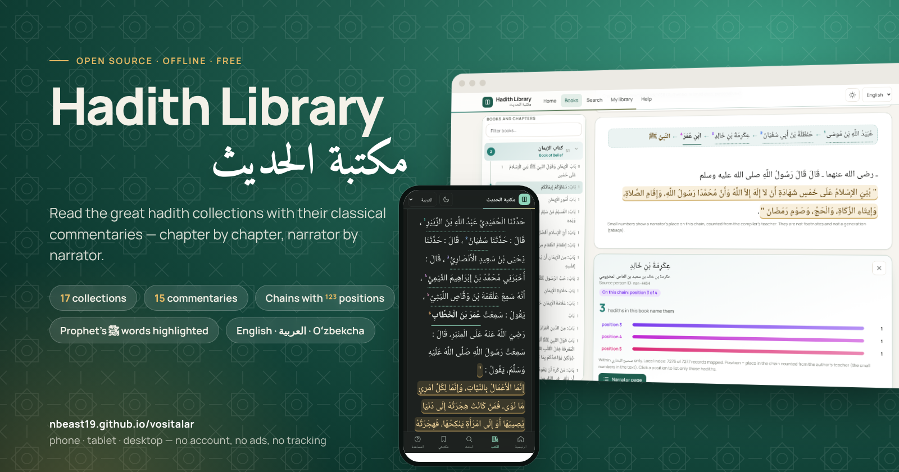
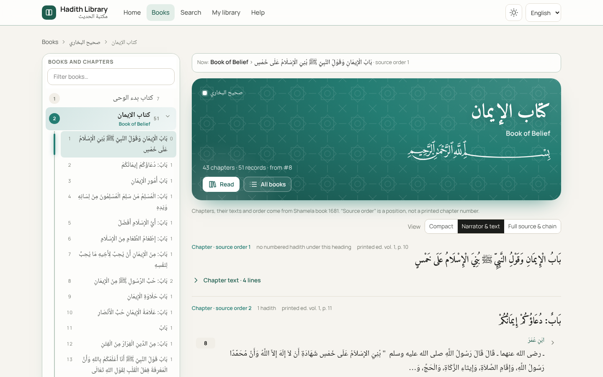
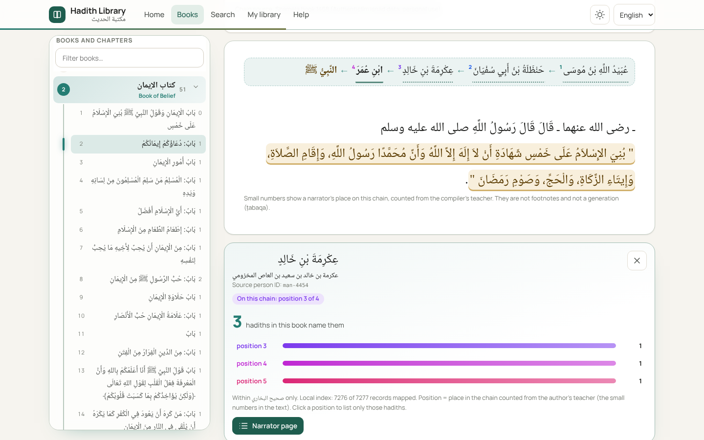
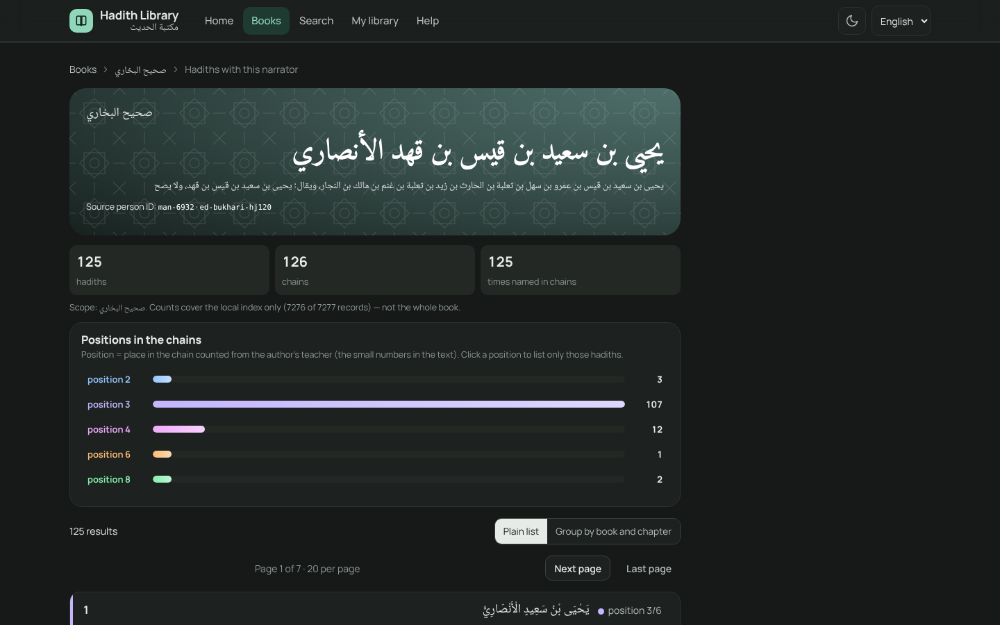
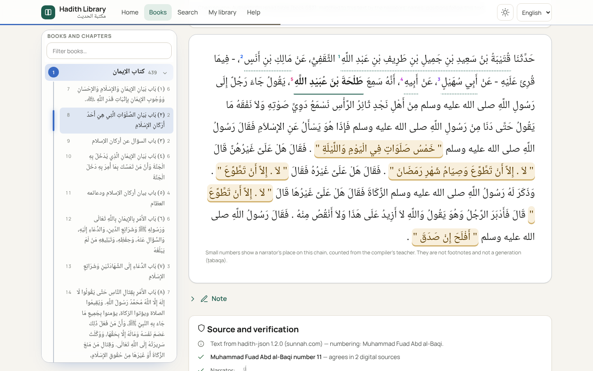

# Vositalar

> **Hadith Library | مكتبة الحديث** — hadith collections and their commentaries, offline, with sources.
> **[Open the app](https://nbeast19.github.io/vositalar/hadis-manba-platformasi/web/)** · [Guide (English)](hadis-manba-platformasi/README.md) · [الدليل (العربية)](hadis-manba-platformasi/README.ar.md) · [Downloads](https://github.com/Nbeast19/vositalar/releases/tag/hadis-manba-paketlar-v1)

## 📖 Hadith Library | مكتبة الحديث

**[▶ Open the app](https://nbeast19.github.io/vositalar/hadis-manba-platformasi/web/)** · [Guide](hadis-manba-platformasi/README.md) · [الدليل](hadis-manba-platformasi/README.ar.md) · [Download books](https://github.com/Nbeast19/vositalar/releases/tag/hadis-manba-paketlar-v1)

A free, open-source library of the great hadith collections — **Sahih al-Bukhari, Sahih Muslim, the four Sunan, the Muwatta, Musnad Ahmad, Riyad as-Salihin, Mishkat al-Masabih** and more — read side by side with their **classical commentaries** (Fath al-Bari, Umdat al-Qari, al-Minhaj, Tuhfat al-Ahwadhi…). It installs like an app on phone, tablet and desktop and then works **offline**.

| | |
|---|---|
| 🗂️ **Book → chapter tree** ¹ | Every Kitāb and Bāb as in the printed edition. The tree stays in place while you read and marks where you are. |
| 🔗 **Chains you can read** ¹ | Every narrator in the isnād gets its position ¹²³. One tap shows **names only**: name ← name ← the Prophet ﷺ — without *ḥaddathanā / ʿan*. Parallel teachers share a position; a taḥwīl chain is numbered on its own. |
| 👤 **Narrator pages** ¹ | How many hadiths in this book mention this narrator, at which positions in the chain (1st, 2nd, 3rd…), in which Kitāb › Bāb — colour-coded; tap any hadith to open it. |
| ✨ **Words of the Prophet ﷺ** | His words are softly highlighted inside the text (display only — the source text is never changed). |
| 📚 **Commentary beside the hadith** | Open Fath al-Bari or another commentary next to the hadith; the commentary leads back to its hadith. |
| 🎨 **A colour for every book** | Light and dark themes, Arabic typography, English · العربية · Oʻzbekcha. No account, no ads, no tracking. |

### بالعربية

مكتبة مجانية مفتوحة المصدر لأمهات كتب الحديث — **صحيح البخاري، صحيح مسلم، السنن الأربع، الموطأ، مسند أحمد، رياض الصالحين، مشكاة المصابيح** وغيرها — تُقرأ مع **شروحها** (فتح الباري، عمدة القاري، المنهاج، تحفة الأحوذي…). تُثبَّت كتطبيق على الهاتف والحاسوب، ثم تعمل **بلا إنترنت**.

- 🗂️ ¹ **شجرة الكتب والأبواب** كما في الطبعة، ثابتة في مكانها أثناء القراءة، تُظهر موضعك.
- 🔗 ¹ **إسناد مقروء:** لكل راوٍ رقم موضعه في الإسناد ¹²³، وبلمسة واحدة **الأسماء فقط**: فلان ← فلان ← النبي ﷺ — دون «حدثنا / عن». الشيوخ المقرونون في موضع واحد، وإسناد التحويل يُرقَّم مستقلًّا.
- 👤 ¹ **صفحة الراوي:** كم حديثًا في هذا الكتاب ورد فيه اسمه، وفي أي موضع من الإسناد، وفي أي كتاب وباب — ملوّنة، وبلمسة يُفتح الحديث.
- ✨ **كلام النبي ﷺ مميَّز** داخل النص (عرضًا فقط؛ نص المصدر لا يتغيّر).
- 📚 **الشرح بجانب الحديث**، والشرح يعيدك إلى حديثه.
- 🎨 **لون لكل كتاب**، وضع فاتح وداكن، خط عربي جميل، والواجهة بالعربية والإنجليزية والأوزبكية. بلا حساب ولا إعلانات ولا تتبّع.

¹ طبقة الأبواب والرواة (من بيانات الشاملة و AuthenticIlm، منشورة بإذن صاحب المصدر) تُثبَّت تلقائيًا مع الكتاب — [التنزيلات](https://github.com/Nbeast19/vositalar/releases/tag/hadis-manba-qatlamlar-v1).

> ¹ **Chapters and narrators layer.** These three features come from a layer that installs automatically with each book (Shamela / AuthenticIlm data, published with the source owner's permission) — [download](https://github.com/Nbeast19/vositalar/releases/tag/hadis-manba-qatlamlar-v1).
>
> **Sources and rights.** Hadith texts: Sunnah.com (shared with permission); commentaries: OpenITI (CC BY-NC-SA 4.0). **The chapter tree and the narrator chains come from a local layer** built from Shamela / AuthenticIlm data whose terms allow research and personal use only — it is built on your own device and is **not** part of the public download ([details](hadis-manba-platformasi/docs/RIGHTS.md)).

---

## 1. Bu nima

Telefonda (iPhone) va kompyuterda ishlaydigan 5 ta oddiy veb-vosita: Qur'on yodlash va murojaa, Zettel kartalarini tekshirish, Anki fayllarini tozalash, YouTube darslar ro'yxatidan Notion uchun CSV yasash va dars transkripsiyasini tozalash. Hamma ma'lumot faqat sizning qurilmangizda saqlanadi, hech qayerga yuborilmaydi. Bir marta ochilgandan keyin internetsiz ham ishlaydi.

Ro'yxatdan o'tish, server yoki kuzatuv kodi yo'q — oddiy HTML, CSS va JavaScript.

## 2. Har bir vosita

### 📖 Hifz — Qur'on yodlash va murojaa
1. Birinchi ochilganda **"Sozlash"** ekrani chiqadi:
   - **Yodlash tartibi** — tayyor shablonni tanlang: *"Boshidan oxirigacha"*, *"Oxiridan boshiga"* (30-juzdan 1-juzgacha) yoki *"O'zim tanlayman"*. Bosqichni sura nomi yoki sahifa raqami bilan qo'shish va o'zgartirish mumkin.
   - **Oldin yodlangan qismlar** (ixtiyoriy) — murojaa uchun; har birini *"kuchli"* yoki *"zaif"* deb belgilang.
   - Kunlik reja, takror soni, murojaa hajmi, kun boshlanish vaqti, ustozga topshirish va dam olish kunlari.
   - **"Tasdiqlash"** ni bosing.
2. **Bugun** ekranida: streak (necha kun ketma-ket), bugungi yangi sahifa va katta **"Takrorladim +1"** tugmasi. Xato bossangiz — **"−1"**. Belgilangan songa yetganda sahifa "yodlandi" bo'ladi va murojaaga qo'shiladi, keyingisi ertaga chiqadi (bugun yana xohlasangiz — **"Yana bir sahifa olish"**).
3. **Bugungi murojaa** — sahifani o'qib bo'lgach **"Takrorladim ✓"**. Qiyin sahifani ⚠️ bilan belgilang — u **Qiyin joylar** ro'yxatiga tushadi va tez-tez chiqadi.
4. Pastda 30 kunlik kalendar: yashil — to'liq, sariq — qisman, kulrang — bajarilmagan.
5. **Statistika** — jami va har bosqich bo'yicha progress, hafta/oy natijalari, taxminiy tugash sanasi.

### 🗃️ Zettel — kartalarni tekshirish
1. `ZK-XX-001` formatidagi `.md` kartalarni yoki butun papkani tanlang (yoki matnni joylashtiring).
2. Natija: tushib qolgan va takroriy raqamlar, buzilgan havolalar, formati noto'g'ri raqamlar, bo'sh kartalar (xato — qizil); yetim kartalar va o'ziga havola (ogohlantirish — sariq); eng ko'p bog'langan 10 ta karta.
3. **"Natijani nusxalash"** yoki **".txt qilib yuklab olish"**. Sinab ko'rish uchun — **"Namunani sinash"**.

### 🃏 Anki — fayllarni tozalash
1. `.txt`/`.tsv` faylni tanlang yoki matnni joylashtiring (har qatorda: Deck, Front, Back, Tags — tab bilan ajratilgan). **"Tekshirish"** ni bosing.
2. Ustun soni xato va bo'sh qatorlar ko'rsatiladi; ortiqcha bo'sh joy va ko'rinmaydigan belgilar avtomatik tozalanadi.
3. **"Oldingi kartalarim"** — eski dars fayllarini bir marta qo'shib qo'ysangiz, yangi faylda allaqachon bor so'zlar ko'rsatiladi (arabcha harakatlarga qaramay solishtirish mumkin).
4. **"Deck qoidalari"** (ixtiyoriy) — deck qanday boshlanishi, kurslar ro'yxati va ruxsat etilgan oxirlari. Bo'sh qoldirilsa tekshirilmaydi.
5. **"Toza faylni yuklab olish"** — Anki'ga to'g'ridan-to'g'ri import qilinadigan fayl.

### 📚 Kutubxona — darslar ro'yxati
1. YouTube ro'yxatini joylashtiring (har qatorda: sarlavha, tab, havola, tab, davomiylik; faqat havolalar ham bo'ladi).
2. Ustoz, kitob, turi va mavzuni yozing, filtrlarni tanlang, **"Tozalash"** ni bosing.
3. Darslar sarlavhadagi raqam bo'yicha tartiblanadi (↑ ↓ bilan qo'lda o'zgartirish mumkin). Chiqarilganlar sababi bilan alohida turadi — **"Qaytarish"** mumkin.
4. **"CSV yuklab olish"** → Notion'da **Import → CSV**.

### 📝 Transkript — matnni tozalash
1. `.txt`, `.srt` yoki `.vtt` faylni tanlang (yoki matnni joylashtiring) va **"Tozalash"** ni bosing.
2. Vaqt belgilari olib tashlanadi, qatorlar birlashtiriladi, paragraflarga bo'linadi, apostroflar bir xil bo'ladi. Arabcha qismlar boshqa rangda ko'rinadi, takrorlangan so'zlar sariq bilan belgilanadi (o'chirilmaydi).
3. **"Hammasini nusxalash"**, **".txt"** yoki **".md"** qilib yuklab olish.

## 3. Telefonga o'rnatish (iPhone)

1. Saytni **Safari**da oching.
2. Pastdagi **Ulashish** tugmasini bosing (kvadrat va yuqoriga strelka ↑).
3. Ro'yxatni pastga suring va **"Add to Home Screen"** ("На экран «Домой»") ni bosing.
4. **"Add"** ni bosing — bosh ekranda "Vositalar" belgisi paydo bo'ladi.

**Yangi versiya:** sayt yangilanganda ilova ichida yuqorida **"Yangi versiya bor — Yangilash"** tugmasi chiqadi. Uni bossangiz, yangi versiya ochiladi. Tugma darrov chiqmasa, ilovani yopib qayta oching.

## 4. Zaxira nusxa

Ma'lumot faqat qurilmaning o'zida. Telefon almashsa, Safari tozalansa yoki ilova o'chirilsa — yo'qolishi mumkin. Shuning uchun:

- **Bosh sahifa → "Hamma vositalar uchun bitta zaxira" → "Hammasini eksport qilish"** — hamma vositalar ma'lumoti bitta faylga (`vositalar-zaxira-YYYY-OO-KK.json`). Faylni iCloud Drive yoki Telegram'dagi "Saqlanganlar"ga saqlang.
- Tiklash: shu yerda **"Hammasini tiklash"** → faylni tanlang → rozilik bering.
- Har bir vositada ham o'z **"Zaxira nusxa"** bo'limi bor (Hifz → Zaxira, Anki, Kutubxona va Transkript sahifasining pastida). Eski versiyada olingan zaxira fayllar ham tiklanadi.
- Hifz 7 kundan ko'p zaxira olinmasa, bosh ekranida eslatma chiqaradi.
- **Muhim:** iPhone'da bosh ekranga qo'shilgan ilova va Safari'dagi sayt ma'lumotni alohida saqlaydi. Ilovani qayta o'rnatishdan yoki sayt manzili o'zgarishidan oldin albatta zaxira oling.

## 5. Taxminlar

Ish davomida qabul qilingan qarorlar — tekshirib chiqing.

**Umumiy**
- Ilova nomi "Vositalar". Ma'lumotlar `vositalar.` bilan boshlanadigan kalitlarda saqlanadi. Eski versiyadagi kalitlar ilova birinchi ochilganda avtomatik ko'chiriladi va eskisi o'chiriladi — sozlamalar va progress saqlanib qoladi.
- Ma'lumot buzilgan bo'lsa, ilova qulamaydi: "zaxira nusxadan tiklang" xabari chiqadi, buzilgan matn alohida saqlab qo'yiladi va "Boshidan boshlash" tugmasi bor.
- Yangilanish: yangi versiya fon rejimida yuklab olinadi va **"Yangilash"** bosilganda o'tadi. Kichik o'zgarishlar ham ilova keyingi ochilishida keshda yangilanadi.
- Zettel hech narsa saqlamaydi (fayllar faqat tekshiriladi), shuning uchun unda zaxira bo'limi yo'q. Kutubxona va Transkript'da faqat sozlamalar saqlanadi.
- Ikonka: yashil fonda ochiq kitob, yozuvsiz.

**Hifz**
- Standart holatda hech qanday yodlash tartibi yoki sahifa raqami qo'yilmagan — foydalanuvchi o'zi tanlaydi.
- "Oxiridan boshiga" shabloni: 30 ta bosqich, 30-juzdan 1-juzgacha; har juz ichida oldinga qarab yodlanadi.
- Madina mushafi, 604 sahifa. Bir sahifada bir nechta sura boshlansa, hammasi ko'rsatiladi (masalan, 604-sahifa: "Ixlos, Falaq, Nos").
- Sura tanlanganda: "dan" — sura boshlanish sahifasi, "gacha" — sura oxirgi sahifasi (keyingi sura boshlanishidan bitta oldin).
- Kunlik 0.5 sahifa — sahifa ikki kunda (1-yarmi, 2-yarmi) yodlanadi; 2 sahifa — kuniga ikkita.
- Murojaa: "necha kun takrorlanmagani" hisoblanadi; zaif va qiyin sahifalarda bu son 2 ga ko'paytiriladi. Yangi yodlangan sahifa dastlabki 3 kun har kuni, 4–7-kunlar kun ora chiqadi. Ketma-ket sahifalar bir guruhda olinadi. Ro'yxat kunning birinchi ochilishida tanlanadi va kun davomida o'zgarmaydi. Juz bilan tanlansa 1 juz = 20 sahifa.
- Kun holati: hech narsa qilinmagan — kulrang; murojaa ham, yangi sahifa ham bajarilgan — yashil; qisman — sariq. Dam olish kunida murojaa yetarli.
- Kun boshlanishi standart 03:00 (bu vaqtgacha qilingan ish oldingi kunga yoziladi). Ilova ochiq turganda yangi kun boshlansa, birinchi bosishda ekran yangilanadi.
- Ustozga topshirish va dam olish kunlari standartda tanlanmagan.
- Streak: bugun hali tugamagan bo'lsa, kechagi kungacha hisoblanadi.

**Zettel**
- Tushib qolgan raqamlar har kitob uchun eng kichik va eng katta raqam orasida qidiriladi.
- Joylashtirilgan matnda `# ZK-...` sarlavhalari bo'lsa, shular bo'yicha bo'linadi; bo'lmasa `---` qatorlari bo'yicha.

**Anki**
- Kurslar, deck boshlanishi va oxirlari ro'yxati bo'sh boshlanadi; bo'sh qoida tekshirilmaydi. Kurs nomi deck yo'lining istalgan qismida bo'lsa yetarli.
- Eski versiyadan ko'chirilganda: kurslar ro'yxati saqlanadi; deck boshlanishi va oxirlari "Oldingi kartalarim" bazasidagi kartalardan avtomatik aniqlanadi.
- Ustun soni xato yoki Front/Back bo'sh qatorlar toza faylga kiritilmaydi. Takrorlar standartda "olib tashlash" tanlangan.
- Fayl nomi deck yo'lining birinchi 3 qismidan (bo'sh joylar `-` bilan): `Arab-tili_Nahv-1_1-bob.txt`.

**Kutubxona**
- Davomiyligi yo'q qatorlar chiqarilmaydi, faqat belgilanadi. Savol-javob so'zlari katta-kichik harfga qaramay qidiriladi.
- Dars raqami: avval `الدرس / الحلقة / المجلس / ح / #` dan keyingi raqam, keyin tartib so'zlari (1–40), keyin sarlavhadagi birinchi raqam.

**Transkript**
- Pauza bo'yicha paragraf faqat har bo'lakda boshlanish va tugash vaqti bo'lsa ishlaydi; aks holda har N gapda paragraf.
- Apostrof faqat o va g harfidan keyin bir xil qilinadi.

## 6. Keyinchalik qo'shish mumkin bo'lgan narsalar

- Hifz: kunlik eslatma (bildirishnoma), ustozga topshirilganlar tarixi, sahifani qisman murojaa qilish.
- Zettel: bog'lanishlarni chizma ko'rinishida ko'rsatish.
- Anki: bazadagi kartalarni qidirish va bittalab o'chirish.
- Kutubxona: bir nechta ustoz/kitob uchun sozlamalarni saqlab qo'yish.
- Transkript: takrorlangan so'zni bir bosishda o'chirish.

---

**Dasturchilar uchun:** hamma sinovlar — `sh testlar/hammasi.sh` (mantiq sinovlari, har xil vaqt mintaqalari va iPhone o'lchamidagi headless brauzer sinovi). Fayllar o'zgarsa, `sw.js` dagi `VERSIYA` raqamini oshiring.
